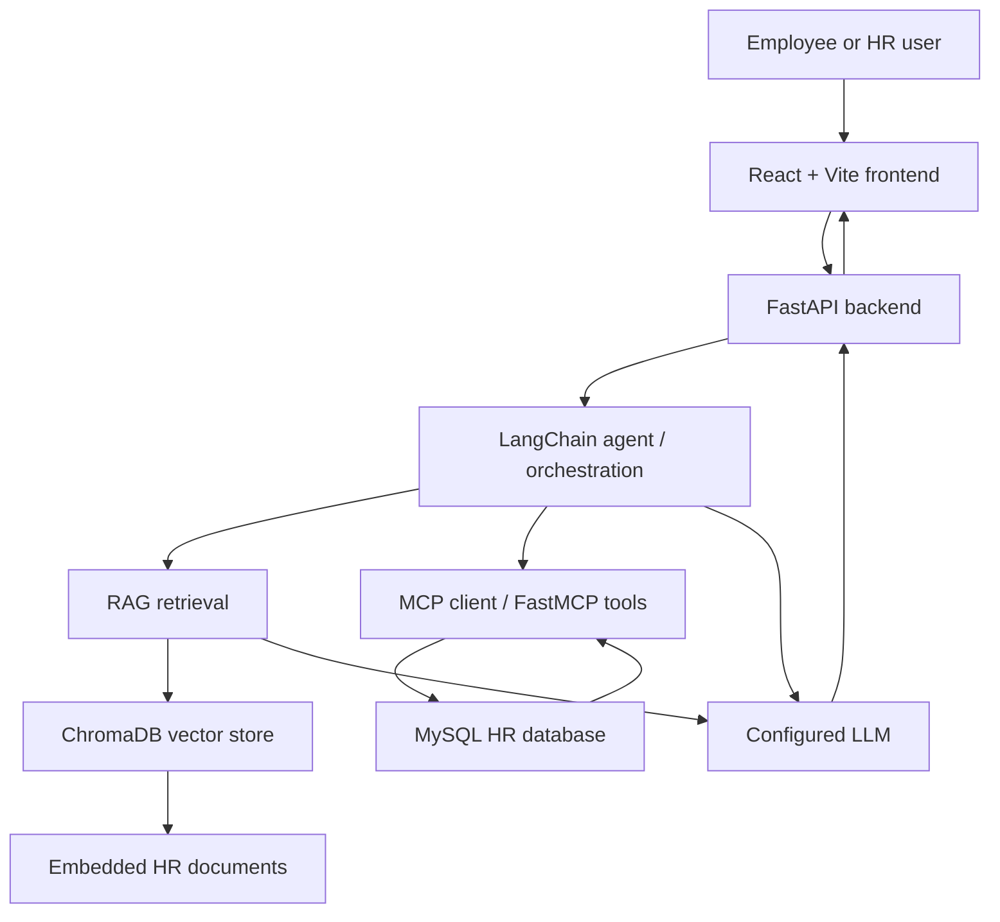

# HR Assistant — RAG, Agents & MCP

An AI-powered HR assistant that helps employees and HR teams retrieve company-policy information and access HR records through a combination of **Retrieval-Augmented Generation (RAG)**, **LLM agent orchestration**, and **Model Context Protocol (MCP) tools**.

The application uses a React frontend, a FastAPI backend, ChromaDB for document retrieval, and MySQL for structured HR data. It supports role-aware workflows and streaming chat responses.

> **Project status:** Academic/portfolio project. Configure authentication, authorization, database permissions, and deployment security carefully before using real employee data.

## Table of Contents

- [Features](#features)
- [Architecture](#architecture)
- [Tech Stack](#tech-stack)
- [How It Works](#how-it-works)
- [Project Structure](#project-structure)
- [Prerequisites](#prerequisites)
- [Setup and Run Locally](#setup-and-run-locally)
- [Configuration](#configuration)
- [API Overview](#api-overview)
- [Security Notes](#security-notes)
- [Future Improvements](#future-improvements)

## Features

- **HR policy Q&A with RAG:** Retrieves relevant context from HR documents before generating an answer.
- **Multiple knowledge collections:** Organizes content into collections such as company policy, employee handbook, employee skills, leave policy, HR policy, and code of conduct.
- **Tool-using agent:** Routes requests to suitable retrieval or structured-data tools.
- **MCP integration:** Exposes HR functions through FastMCP tools, including employee details and leave-balance lookups.
- **MySQL integration:** Uses a relational database for structured HR data.
- **Role-aware workflows:** Supports employee and HR roles, with employee-facing access intended to be restricted to the signed-in employee's own information.
- **Streaming chat:** FastAPI streaming endpoint delivers responses progressively.
- **Announcements support:** Includes an announcements table for company updates.
- **Leave-calendar rules:** Calendar logic accounts for Sundays, second and fourth Saturdays, and Indian public holidays.

## Architecture



## Tech Stack

| Layer | Technologies |
|---|---|
| Frontend | React, Vite |
| API | Python, FastAPI |
| Agent orchestration | LangChain / LangGraph (depending on the configured workflow) |
| Retrieval | RAG, ChromaDB |
| Embeddings | `bge-base-en-v1.5` |
| Structured data | MySQL |
| Tool integration | Model Context Protocol (MCP), FastMCP |
| Model runtime | Ollama for local inference; Gemini/Groq were also used during development |
| Streaming | FastAPI streaming with `astream_events` |

Exact package versions and model names depend on your current environment. Keep your installed dependencies in the repository's requirements/lock files.

## How It Works

1. A user submits a question through the React chat interface.
2. The FastAPI backend passes the request into the agent workflow.
3. The workflow chooses an appropriate path:
   - **Policy or handbook question:** retrieve relevant document chunks from ChromaDB.
   - **Structured HR question:** call an available MCP tool that queries HR data.
4. The configured language model uses the available context or tool results to compose a response.
5. The backend streams the response back to the frontend.

RAG and database tools solve different problems: RAG is suited to questions grounded in documents, while SQL-backed tools are better for current structured records such as an employee's leave balance.

## Project Structure

Your exact folders may differ; adjust this example to match the repository before publishing.

```text
hr-assistant/
├── frontend/              # React + Vite UI
├── backend/               # FastAPI routes and agent workflow
├── mcp_server/            # FastMCP tool definitions (if separated)
├── vectordb/               # Local ChromaDB persistence (usually not committed)
├── documents/              # Source HR documents (check permissions before committing)
├── .env.example            # Safe configuration template
├── .gitignore
├── requirements.txt
└── README.md
```

## Prerequisites

- Python version supported by your installed dependencies
- Node.js and npm
- MySQL server
- Ollama, if running a local model
- Git

## Setup and Run Locally

The commands below are a starting point. Replace folder names, module paths, and environment variables with those used in your repository.

### 1. Clone the repository

```bash
git clone <YOUR_REPOSITORY_URL>
cd hr-assistant
```

### 2. Configure the backend

Open a terminal in the backend directory and create a virtual environment:

```powershell
python -m venv .venv
.\.venv\Scripts\Activate.ps1
python -m pip install --upgrade pip
pip install -r requirements.txt
```

If PowerShell blocks activation, you can use the activation method appropriate for your machine or run the environment's Python executable directly.

### 3. Configure MySQL

Create a local database and configure the database connection using environment variables. The exact schema and initialization commands depend on the SQL setup in this repository.

Example SQL:

```sql
CREATE DATABASE hr_system;
```

Use a dedicated local development account with only the permissions it needs. Do not commit real employee records or database credentials.

### 4. Configure environment variables

Create a local `.env` file based on `.env.example` and fill in the values required by your application.

Example placeholders (rename them to match the code):

```dotenv
MYSQL_HOST=localhost
MYSQL_PORT=3306
MYSQL_DATABASE=hr_system
MYSQL_USER=your_local_user
MYSQL_PASSWORD=replace_me

OLLAMA_BASE_URL=http://localhost:11434
OLLAMA_MODEL=gemma4

# Add other keys only if your configured provider requires them.
# GEMINI_API_KEY=
# GROQ_API_KEY=
```

Never commit `.env`, API keys, passwords, JWT secrets, or real employee data.

### 5. Start Ollama (if using a local model)

Install Ollama, pull the model configured by your code, and make sure the Ollama service is running. For example:

```bash
ollama pull gemma4
ollama list
```

Use the exact model tag installed on your machine. Model availability and resource requirements vary.

### 6. Start the backend

From the backend directory, run the FastAPI application using the actual module path in your repository. For example:

```bash
uvicorn main:app --reload
```

If your entry point is in a package or has a different filename, adjust the command accordingly.

Once running, open `http://127.0.0.1:8000/docs` to inspect the available API routes.

### 7. Start the frontend

In a separate terminal:

```bash
cd frontend
npm install
npm run dev
```

Open the local URL printed by Vite (commonly `http://localhost:5173`).

### 8. Verify the application

- Confirm that the frontend can reach the FastAPI backend.
- Confirm that MySQL is running and the configured database is reachable.
- Confirm that the vector store has been initialized and the expected collections are available.
- Confirm that the configured LLM provider is reachable.
- Test employee and HR flows using non-sensitive development data.
- Verify that employees cannot retrieve another employee's records by changing IDs or calling endpoints directly.

## Configuration

The project may use different settings depending on whether it runs locally through Ollama or through a hosted model provider.

| Setting | Purpose |
|---|---|
| MySQL connection variables | Connect to the HR database |
| LLM provider/model | Select the model used for responses |
| Embedding model | Generate vectors for document retrieval |
| ChromaDB persistence path | Store and load the vector database |
| Frontend API URL | Point React to the FastAPI backend |
| CORS origins | Restrict which frontend origins may call the API |

Keep secrets in environment variables. Avoid hardcoding localhost URLs throughout the code; centralize configuration where practical.

## API Overview

The backend includes a streaming chat endpoint (`/chat-stream`) and employee-related routes, including an employee lookup route. The exact request/response schemas should be confirmed in the current source code or FastAPI's `/docs` page.

| Endpoint / component | Purpose |
|---|---|
| `/chat-stream` | Stream assistant responses to the frontend |
| `/employee/{id}` | Employee-related lookup route; enforce authorization server-side |
| MCP `employee_details` tool | Retrieve employee details |
| MCP `leave_balance` tool | Retrieve leave-balance information |
| Announcements table | Store company announcements |

Use `/docs` as the source of truth for the currently registered API endpoints.

## Security Notes

This project handles HR-like information, which can be sensitive. Before any real-world deployment:

- Enforce authorization in the backend and in every tool—not only in the UI or agent prompt.
- Derive the employee identity from a verified session/token; do not trust a user-supplied employee ID alone.
- Apply least-privilege database permissions and parameterized queries.
- Keep credentials and provider API keys out of source control.
- Use synthetic or anonymized data in development and demos.
- Validate and limit tool inputs, and log tool access without logging unnecessary personal data.
- Configure CORS, HTTPS, rate limits, and secure session/token handling for deployment.
- Treat retrieved documents and tool output as untrusted input; do not let document text override system or access-control rules.

## Future Improvements

- Add automated tests for retrieval, tool selection, permissions, and streaming.
- Add document ingestion and re-indexing commands with source metadata.
- Add citations or source snippets to policy answers.
- Improve observability with structured logs, latency measurements, and tool-call tracing.
- Add Docker-based local setup and deployment documentation.
- Add evaluation datasets for retrieval quality and answer groundedness.
- Add robust authentication, authorization, audit trails, and deployment hardening.

## Contributing

For personal or academic use, feel free to fork the project and adapt it. Before sharing changes, ensure no secrets, private documents, or real employee data are included.

## License

Add a license file if you intend to publish the project for reuse. Do not claim a license until one has been selected.
